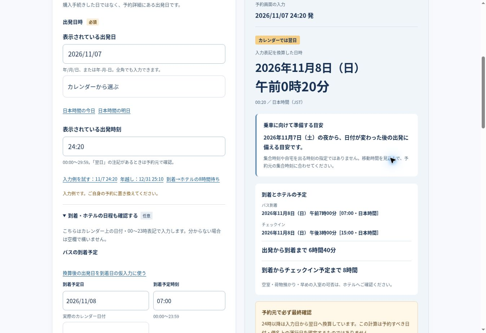

# 日付入力の公開ブラウザ検証（2026-10-26・日本時間）

## 結論

公開サイトのデスクトップChromeで日付入力・計算・補助ボタン・メモ・共有・ICS保存を操作した。日付選択欄から手入力欄へフォーカスを奪う不具合を修正し、mainへの反映、Cloudflare Pagesのデプロイ成功、公開サイトでの修正反映を確認した。

**Android実機、スマートフォン幅、OSの日付選択ポップアップ、カレンダーアプリへの取込は未検証。これらを合格扱いにしない。**

## バージョン・公開状況の照合

- 開始時main: `7c4357f43e8334d4d5bfb3a021936874cdfca186`。依頼で指定されたコミットと一致。
- 開始時Cloudflare Pagesチェック: success、デプロイ `922b029c-c7a4-4cf0-a3e4-bc551d1025ef`。
- 修正コミット: `62876a80f1d1c5da53aeff6e37da2aa4d0494440`。
- 修正後Cloudflare Pagesチェック: success、デプロイ `822e6f85-6199-4888-8205-fd90aac84b41`。
- 本番: https://bus-date-navi.pages.dev/ 。再読込後に修正前と同じ操作を行い、ネイティブ日付入力にフォーカスが残ることを確認した。
- デプロイチェックと本番の実動作で照合。全配信ファイルのバイト単位の一致は未確認（実行環境からの直接取得が制限されたため）。

## 実ブラウザの確認結果

利用環境はリモートのデスクトップChrome。実測したページ幅は1348 CSS px。

| 操作・入力 | 実際の結果 |
|---|---|
| 2026/11/07 24:20 | 2026年11月8日 午前0時20分・JST |
| 同便の到着11/08 07:00、ホテル11/08 15:00 | 乗車6時間40分、到着後の待ち8時間を別々に表示 |
| 2026/11/07 25:10 | 11月8日 午前1時10分 |
| 2026/12/31 25:10 | 2027年1月1日 午前1時10分 |
| 日本時間の今日／明日 | 2026-10-26／2026-10-27。日付選択欄にも同期 |
| 年越し後に「換算後の出発日を到着日の仮入力に使う」 | 到着日2027-01-01 |
| 続けて「入力した到着日をホテル予定日に使う」 | ホテル日2027-01-01。日付選択欄にも同期 |
| 到着カレンダーを2026-11-09へ変更しホテル補助を押す | ホテルの手入力欄・日付選択欄とも2026-11-09 |
| 出発・到着・ホテルの日付選択欄をそれぞれ変更 | 手入力欄へ反映。フォーカスは操作中の日付選択欄に残る |
| 出発カレンダーで上・下キーを連続操作 | 11月→12月→11月と変更でき、フォーカスを保持 |
| 出発カレンダーの月をBackspaceで消し11を入力 | 年・日を失わず2026-11-07へ復帰 |
| 計算・メモ表示後に3つの日付選択欄をそれぞれ変更 | 古い結果・確認メモを非表示、ICSリンクを非表示にしhrefを削除 |
| 今日・明日、日付補助、手入力変更、30:00で再計算、全消去 | 古い結果・ICSリンクが利用可能な状態では残らない。不正時刻はエラー |
| 確認メモの表示・結果コピー | 正しい日付、乗車6時間40分、ホテル待ち8時間を含む。コピー成功通知を確認 |
| 紹介文表示・「このツールを共有」 | このChromeでは紹介文とURLをクリップボードへコピー。乗車日・時刻・ホテル予定を含まないことを実際のコピー内容で確認 |
| 仮の乗車メモを保存 | 本番からICSファイルを保存し、下記の日時・仮予定属性を確認 |

非表示の結果要素には直前のテキストがDOM上に残るが、画面・アクセシビリティツリーからは隠れ、操作可能な古い予定リンクのhrefは削除される。再計算するまでは旧結果を表示しない。

### 本番で保存したICS

入力は2026/11/07 24:20。実際にダウンロードしたファイルを検査した。

```text
DTSTART:20261107T152000Z
DTEND:20261107T155000Z
STATUS:TENTATIVE
TRANSP:TRANSPARENT
SUMMARY:仮の乗車メモ・予約元で要確認
```

開始はJSTの11月8日0:20、終了は0:50。30分の仮予定として整合する。カレンダーアプリへの登録・表示やAndroidでの取込は行っていない。

## 発見した不具合と修正

- 再現: 「カレンダーから選ぶ」を開き、日付入力の月を上キーで変更する。
- 修正前: `useDate()`が常に手入力欄の`focus()`を呼び、1回の変更で日付選択欄からフォーカスが移る。連続した日付調整を妨げる。
- 修正: 日付選択欄のイベントではフォーカスを移さない。今日・明日や日付補助ボタンでは従来のフォーカス移動を維持する。
- あわせて、同期先の日付が同じならネイティブ入力へ再代入しない。部分編集中の値や選択セグメントを不要にリセットしない。
- 入力変更時の結果非表示、メモ非表示、Blob URL破棄、ICSリンクのhref削除は維持。

## 自動回帰確認

- `node --test tests/*.test.mjs`: **89 passed / 0 failed**。
- `node scripts/check-site.mjs`: **146 passed / 0 failed**。
- 追加した`tests/picker-editing.test.mjs`は、3つの日付欄のフォーカス維持・部分編集への再代入防止・旧結果/メモ/リンク無効化・旧Blob URL失効・補助ボタンの同期を検査する。
- 追加テストを修正前のコードでも実行し、出発・到着・ホテルの3欄でフォーカス維持の検査が失敗することを確認。修正後はすべて成功。
- 日時計算・共有モジュール、広告設定、プライバシー方針、セキュリティヘッダーは変更していない。追加パッケージ、有料サービス、外部への投稿・カレンダー登録もなし。

## 未検証と次の確認

1. Android Chromeの実機で日付ポップアップを開き、出発・到着・ホテルの日付を確定・キャンセルする。
2. 320〜430 CSS px程度の画面で、日付選択・補助ボタン・結果・共有/メモ/ICS導線が押せるか確認する。本環境は幅変更が制限されており、デスクトップ幅の検査を代用して合格とはしていない。
3. Androidの共有シートとカレンダー取込先で、予定を送信・登録する前の内容を確認する。

デスクトップChromeの日付入力欄の値変更・キーボード操作は確認済みだが、標準の日付ポップアップ内のカレンダーをクリックして選ぶ操作は確認できていない。

## 公開確認の画面


